# 工业品导购 Agent

用一句自然语言描述采购需求，Agent 自动完成「意图识别 → 需求解析 → 缺参追问 → 混合检索 → 生成推荐」，直接给出可下单的商品清单（型号、单价、MOQ、交期、推荐理由）。

面向工业品 B2B 采购场景：SKU 规格高度相似（光 M8 螺丝就有几十种），采购真正想说的是「304 不锈钢 M8×30 内六角，要 1000 个」，而不是在目录里一级级点筛选；说漏了参数时，又要能主动追问。

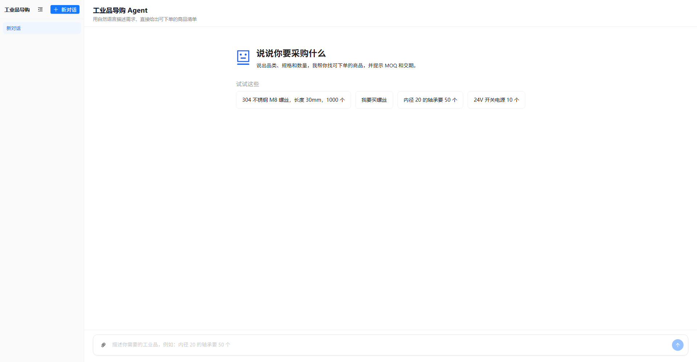

助手回复里的推荐正文用 Markdown 渲染，商品卡片挂在气泡下方：

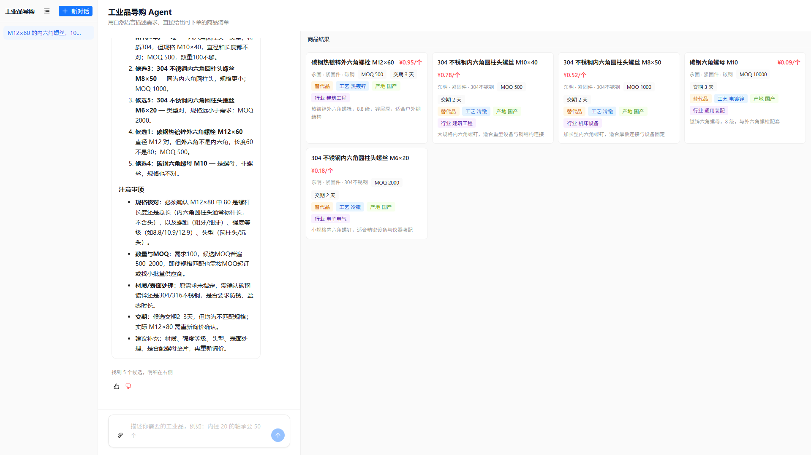

## 演示问句

10 条问句覆盖三类能力（完整采购 / 缺参追问 / 闲聊兜底），2026-11-13 实测全部通过：

| # | 用户问句 | 期望行为 | 实测结果 |
| --- | --- | --- | --- |
| 1 | 304 不锈钢 M8×30 内六角螺丝，要 1000 个 | 直接出清单 | `results`，推荐圆柱头 M8×30 ¥0.35/个，MOQ 1000 正好满足；另有沉头、加长版候选 |
| 2 | 我要买螺丝 | 缺螺纹规格，追问 | `clarify`：「你要买哪种螺纹规格的螺丝，比如 M8？」 |
| 3 | 内径 20 的轴承要 50 个 | 出清单并校验 MOQ | `results`，3 个内径 20mm 候选；普通轴承 MOQ 100 不够，优先推荐 MOQ 50 的陶瓷轴承 |
| 4 | 要能耐高温的轴承 | 缺内径，追问 | `clarify`：「这个耐高温轴承的内径需要多大，比如 20mm？」 |
| 5 | 24V 开关电源 10 个 | 直接出清单 | `results`，命中 S-350-24 ¥85/个，10 个 ≥ MOQ 5 |
| 6 | 断路器 16A | 按电流精确匹配 | `results`，C16 2P 排第一（唯一完全匹配 16A），C32 3P 在候选中但电流不符 |
| 7 | 碳钢镀锌 M8×30 外六角螺栓 2000 个 | 材质 + 规格同时命中 | `results`，8.8 级外六角 ¥0.22/个，2000 个约 ¥440 |
| 8 | 交流接触器 220V | 多候选排序 | `results`，CJX2-1210（12A）→ CJX2-2510（25A）按功率排序 |
| 9 | 今天天气怎么样 | 不当成采购，自然回应 | `chat`：「天气我这边查不到，不过采购上您要找什么品类、规格和数量？」 |
| 10 | 螺丝和螺栓有什么区别 | 知识问答 + 引导回采购 | `chat`：「螺栓通常配螺母，螺丝多直接拧入工件。您要采购的是螺栓还是螺丝？」 |

> 完整自测清单（含多轮组合、库外品类、接口抽查）见 [docs/test-checklist.md](docs/test-checklist.md)。
>
> 第 2、4 条以前会被当成「缺参采购」反复追问品类；第 9、10 条以前会被追问「你要买什么品类」，现在是明确的闲聊/知识分支。

多轮补充同样支持：先问「我要买螺丝」，追问后回「m8」，再补「50mm」，出 M8×50 清单；接着说「要 2000 个」，数量会更新而不是沿用 1000。规格写小写 `m8` 也认；中间插一句「问题一个一个来，我都不知道回哪个了」，上下文也不会丢。

多需求也走同一条链路：说「螺丝 M8 和 M10 各要 1000 个」，拆成两行分别检索，右侧表格一行一张单；点追问按钮时也可以多选（`M8, M10` 一起填进输入框）。

## 能力拆解

### 1. 意图判断：规则优先，LLM 兜底

`demand.detect_intent()` 先用词表快速分流，判不出来才交给 LLM，避免每句话都多一次模型调用：

- 有品类词（螺丝/轴承/接触器…）且带参数、材质、数量或购买词（买/采购/要/有没有…）→ `purchase`
- 有品类词但问的是知识（是什么/怎么选/有什么区别…）→ `chat`
- 命中问候、天气、谢谢等词 → `chat`
- 其余 → `unknown`，调 LLM 用 8 token 判一次，出错按 `purchase` 处理（保持原行为，不影响采购主链路）

### 2. 需求解析：品类 / 材质 / 参数 / 数量

`demand.parse_demand()` 用规则抽结构化字段，并生成检索改写 query：

- 品类：紧固件 / 轴承 / 电气元件
- 材质：304 不锈钢 / 碳钢
- 参数：`内径 20`、`长度 30`、`M8`、`24V`、`16A`
- 数量：`1000 个`（单位支持 个/件/只/根/片/套/台/米）

改写后的 query 会把品类、材质、规格拼进去，弥补短查询的语义缺失（例如「内径 20 的轴承」→ `轴承 内径 20mm 内径 20 的轴承`）。

### 3. 缺参追问：一次只问一个

品类缺失 → 问品类；紧固件先问螺纹规格（M 号），规格拿到了再问长度；轴承缺内径 → 问内径。追问文案交给 LLM 生成（temperature 0.3），模型不可用时回落固定模板，保证演示不中断。

规格和长度分开问是刻意的：M8 能对上几十个 SKU，长度 30 还是 50 往往直接决定选哪款；一次问两个，用户反而不知道该先回哪个。

每次追问会同时返回一组可点选的标准规格（`options` 字段），前端渲染成按钮，用户点一下就当作一句话发出去，不用手打：

- 问品类 → 紧固件 / 轴承 / 电气元件
- 问螺纹规格 → M4 / M5 / M6 / M8 / M10 / M12
- 问长度 → 10mm / 15mm / 20mm / 30mm / 40mm / 50mm / 60mm
- 问内径 → 8mm / 10mm / 12mm / 15mm / 20mm / 25mm / 30mm

按钮给的是行业标准规格，不是库里现有 SKU 的列表。演示库里只有 45 条数据，按库存生成会让人误以为只卖两三种长度；实际采购里，「标准规格有、现货不一定有」才是常态，没货再谈货期。

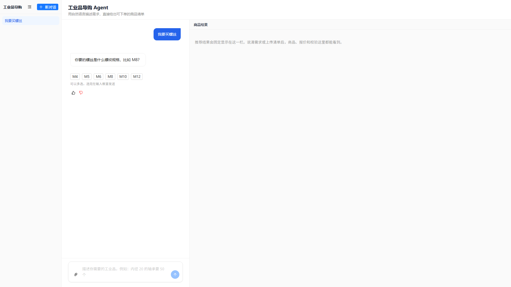

### 4. 多轮上下文：继承上一轮的需求，而不是从头问

前端把最近 4 轮对话一起提交（`POST /api/chat`，body 为 `q` + `history`）。后端两条路合并上下文：

- **补充句拼接**：当前句不含品类词、不含库外词、不像闲聊、也没有「吗 / 什么 / 怎么」这类独立提问标记时，判定为补充，把上一轮用户原话和当前句拼起来再解析。
- **需求继承**：`history_demand()` 回放最近 4 条用户原话，逐条解析后累积成一份历史需求（后说的覆盖先说的）；当前句解析不出品类时，`merge_demand()` 用历史品类和材质兜底，参数以当前句为准。

效果：

- 「我要买螺丝」→ 追问 M8 →「m8」→ 追问长度 →「50mm」→ 出 M8×50 清单
- 「304 不锈钢 M8 螺丝 1000 个」→「要 2000 个」→ 数量更新为 2000
- 「我要买螺丝」→「m8」→「问题一个一个来，我都不知道回哪个了」→ 继续问长度，抱怨句不会把上下文冲掉

参数和数量都取最后一次出现的值，新补充的信息总能覆盖旧的。`GET /api/chat?q=` 仍然保留，不带历史，等价于单轮。

### 5. 库外品类：如实说没有，不硬凑

query 命中工具、劳保等库外品类词（扳手、螺丝刀、电钻、手套……）时，直接返回 `stage="out_of_scope"`：说明本店只收录紧固件、轴承、电气元件三类，并给一个就近替代方向（比如买扳手 → 可看对应规格的螺栓螺母），不再追问该品类的规格，也不假装有货。同时把「只有三类」写进追问和闲聊的 system prompt，避免模型编出「五金、手动工具、劳保」这类库里不存在的品类。

### 6. 混合检索：向量 + BM25 + RRF + 硬过滤 + 精排

- 向量召回：bge-m3（1024 维）编码商品文本，FAISS `IndexFlatIP` 检索，取 `top_k×5` 扩大候选
- 关键词召回：jieba 分词后 BM25，同样取前 N
- 融合：RRF（K=60）合并两路排名，不依赖两路分数的量纲
- 硬过滤：query 里出现 `内径/长度/M 号` 时对候选做精确匹配（`M8×30` 这种写法会同时抽出规格和长度）；过滤后为空则回退到融合结果，避免参数写错时零结果
- 头型重排：query 里有「内六角 / 外六角 / 沉头 / 圆柱头」这类词时，命中词的商品排到前面，但不硬删其它头型（用户可能没想清楚）
- **精排**：融合结果的前 20 条交给 `bge-reranker-base`（cross-encoder，XLMRoberta）逐条打分重排，再取前 5。模型走 `D:\AI\models\bge-reranker-base`，懒加载 + 启动后台预热，加载失败自动降级回规则重排（`backend/app/rag/reranker.py`）

**为什么精排没有独占排序权**：实测发现 cross-encoder 对「产地 = 德国」这类结构化约束不敏感——「德国进口的 6204 轴承」它会把国产 S6204 排到进口件前面。所以最终排序键是 `(品类是否匹配, 软属性命中数, 精排分)`：跨品类的压后，软属性命中的优先，精排只用来在同分内分辨谁更贴题。这是「模型给语义、规则守约束」的分工。

实测耗时：加载 16 秒（一次性），20 条候选打分 26 毫秒；整轮对话 5.3–7.4 秒（含理解层与推荐生成）。

### 7. 推荐生成：把候选交给 LLM 做取舍

检索出候选后，把商品的结构化信息（名称/品牌/价格/MOQ/交期/描述）拼成编号列表喂给 LLM，要求它按匹配度排序、给推荐理由、校验 MOQ、指出不匹配点。LLM 失败时回退模板输出，保证任何情况下都能出清单。

### 8. 前端渲染：Ant Design X 组件 + Markdown

界面用 `@ant-design/x` 搭建：`Bubble.List` 渲染对话气泡，`Welcome` + `Prompts` 做空态引导（点示例直接发送），`Sender` 做输入区；助手回复走 `@ant-design/x-markdown` 的 `XMarkdown`，标题、加粗、有序/无序列表都能正常排版，不会再把 `**` 当普通字符打印出来。商品卡片和逐行表格不在气泡里，统一放到右侧结果区（见第 12 节），对话里只留一句「N 个候选，明细在右侧」。

### 9. 文件与截图上传：清单进、报价单出

`POST /api/chat/upload` 收一个文件，按后缀分流：`.xlsx / .xlsm` 走 `backend/app/excel.py` 解析表头；`.png / .jpg / .jpeg / .webp / .gif / .bmp` 走 `backend/app/vision.py`，把图交给 DeepSeek 的 `deepseek-flash` 视觉模型，要求它只输出 `{"items":[{"name","spec","material","quantity","unit"}]}`，再用同一套逐行匹配。

Excel 侧：在前 5 行里找命中列名最多的一行当表头（`物料名称 / 规格型号 / 数量 / 单位 / 材质 / 品牌` 这几类词），认不出表头就按「第一列品名、第二列规格」猜；每行拼成一句自然语言，复用对话那条链路的需求解析与检索。

每行都过同一个 `evaluate_row()`，所以对话里和表格里判断一致，一共八种结果：库外品类、缺品类、缺参数（比如只说了 M8 没说长度）、库里无匹配、仅替代（没有精确规格，给的是替代候选，并写明「长度要求 80mm，候选 60mm」这类差异）、属性不符（要进口给的是国产）、低于起订量、可下单。合计行、小计行、空行自动跳过。整表只做一次汇总统计，不逐行调 LLM，几十行也能秒出结果。

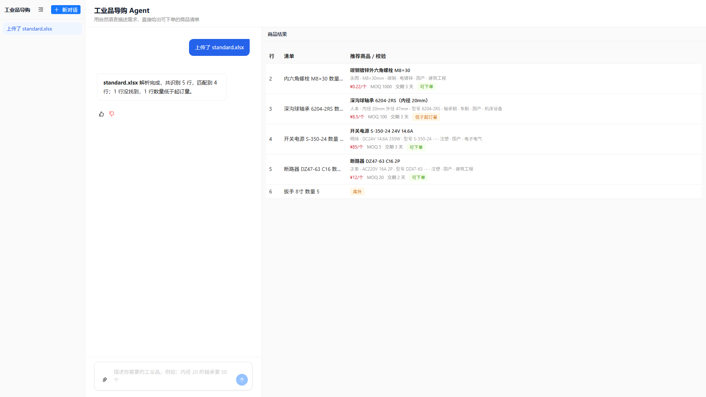

图片识别用同一个 `DEEPSEEK_API_KEY`，不需要另开 OCR 账号；一张采购单截图约 1000–1500 token，识别加匹配几秒出结果。识别结果先以表格回显，用户看一眼再决定要不要下单，而不是识别完直接报价。

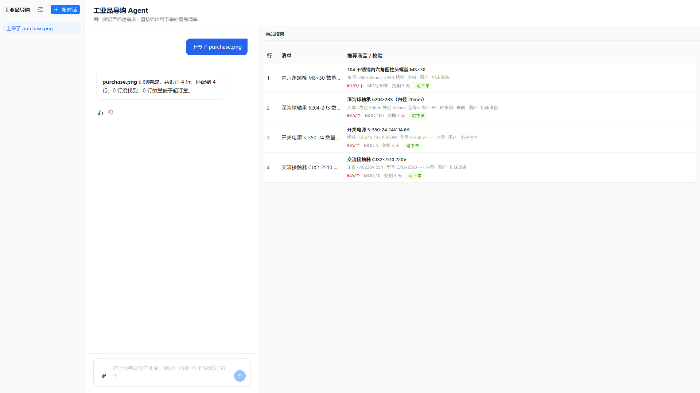

### 10. 会话管理：刷新不丢、可以开新对话

会话和消息落在 SQLite 里（`sessions` / `messages` 两张表，见 `backend/app/sessions.py`），前端只负责渲染。打开页面先拉会话列表，优先恢复上次打开的那条（浏览器里存了 id），没有就新建一条；点「新对话」建新会话，点列表里的任意一条切换，悬停右侧叉号删除。

`POST /api/chat` 带上 `session_id` 后，历史直接从库里取（比前端传的更完整），用户消息和助手回复都会落库；不带 `session_id` 时行为和之前一致，老脚本不用改。上传接口同样收 `session_id`，表格只存渲染需要的字段，不把完整商品对象写进消息表。

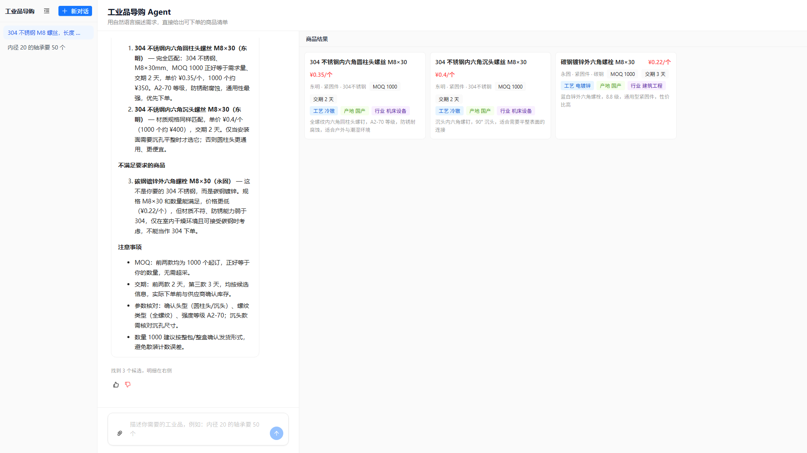

### 11. 评价：一个按钮，一条可分析的信号

每条助手回复下面有一对 👍 / 👎，只点一下、不用填任何东西——愿意多说一句的用户自然会去反馈，强制填写只会让人干脆不点。

评价落在 `feedback` 表（`message_id` 做主键，一条消息只留最后一次评价，改评就覆盖），`GET /api/feedback/stats` 返回好评数、差评数、评价率和有评价的回答占比。

这条线的价值不在按钮，在**怎么用差评**：把差评对应的回复拉出来，能分出是意图判错、检索没召回到、还是回复里编了参数，再针对性改提示词或检索。面试里讲「上线后怎么迭代」，比只讲功能完整更有说服力。

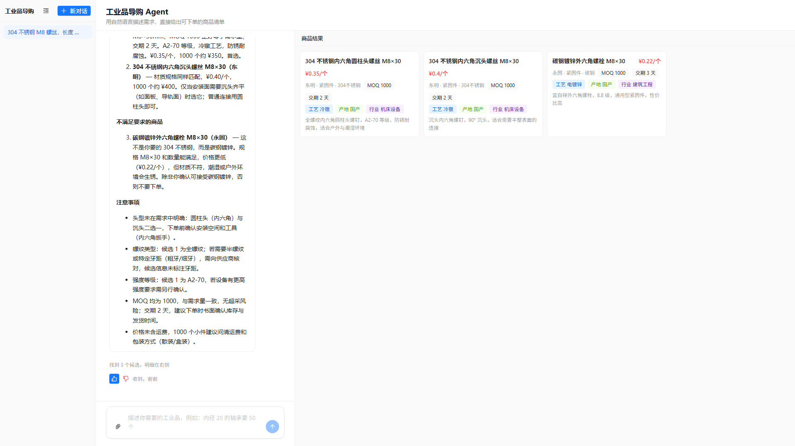

### 12. 三栏布局：把「在聊什么」和「找到什么」分开

页面分成三栏：左边会话列表（可折叠），中间对话，右边商品结果区。没开始对话时仍然是整页欢迎页；说上第一句话、或者点开一条历史会话之后，右侧才分出来。

分栏的理由很实际：这个界面的目的是「买东西」，不是聊天，所以宽度是**对话固定 480px、商品区吃掉剩余**——1440 屏下商品区约 730px，1920 屏下约 1200px，屏幕越大能同时看到的候选越多。商品卡片按 280px 自动分列，一屏能看 4–6 个，不用来回滚。

历史会话栏可以折叠成 56px 窄条（只留新建按钮和每条会话的首字图标），折叠状态存 `localStorage`，刷新后保持——想把屏幕全留给商品时点一下就行。

- **单需求**：右侧显示商品卡片（名称、单价、MOQ、交期、材质、工艺、产地、适用行业）
- **多需求**：右侧显示逐行表格，一行一张单；`推荐商品 / 校验` 列里每个商品都列全属性（品牌 · 规格 · 型号 · 材质 · 工艺 · 产地 · 行业，外加单价 / MOQ / 交期），最后一行是判断（`可下单` / `缺参数` / `缺品类` / `库外` / `无匹配` / `仅替代` / `属性不符` / `低于起订量`）
- 结果区固定显示**最近一条带商品的消息**，切换会话跟着走；新开一条会话时回到占位文案

判断不是一句随手写的文案，而是后端 `evaluate_row()` 按固定顺序算出来的一个状态：库外 → 缺品类 → 缺参数 → 无匹配 → 仅替代 → 属性不符 → 低于起订量 → 可下单，前端只负责把这个状态翻成短标签和颜色。同一行在「刚说完」和「刷新后重看」显示的是同一个结论，因为状态是跟消息一起落库的。

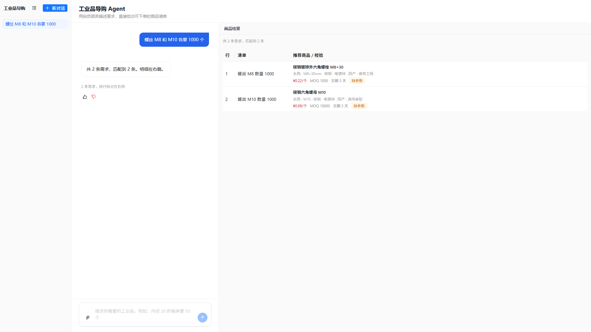

**多选**：追问时给的是标准规格按钮（`M4 / M5 / M6 / M8 / M10 / M12`），点一下切换选中、可以连着点几个，选中项按英文逗号加空格拼起来（`M8, M10`）**填进输入框**，由用户确认后发送——不替用户做决定，也方便手改成更细的说法。

**多需求识别**分两段：

1. 规则先判「像不像多需求」，判据是**不同 M 号的个数 ≥ 2**、**不同品类个数 ≥ 2**，或**不同内径/长度值 ≥ 2**（`25mm, 30mm`）。不用「和」字判，因为「304 和 316 的 M8 螺丝」是一个需求（材质并列），用「和」切就错了
2. 判成多需求才调一次 LLM 做结构化拆分，输出 `{"rows":[{"name","category","spec","material","quantity"}]}`；说「各要 1000 个」时每行都填 1000；拆不出来退回单需求，不硬切

多行里的某一行缺参数时**不逐行追问**（会把用户绕晕），直接按已有信息给参考候选并标「缺参数」；连品类都没看出来的行标「缺品类」，不瞎推。

### 13. 八个维度：从「找得到」到「选得对」

商品表不止有名字和价格，八个维度都落了库：

| 维度 | 存什么 | 例子 |
| --- | --- | --- |
| 品类 | 三选一 | 紧固件 / 轴承 / 电气元件 |
| 规格 | **选型参数**，用户下单时要核对的 | `M8×30mm`、`内径 20mm 外径 47mm`、`AC220V 16A 2P` |
| 型号 | **厂家型号**，用户会直接报的那串字符 | `6204-2RS`、`DZ47-63`、`CJX2-1210`、`S-350-24`（标准件填 `-`） |
| 品牌 | 厂家 | 东明、永固、人本 |
| 材质 | 材料等级 | 304 不锈钢、碳钢、陶瓷 |
| 工艺 | 成型/表面处理 | 冷镦、车削、电镀锌、注塑、烧结 |
| 产地 | 国产 / 进口国家 | 国产、进口·德国、进口·日本 |
| 应用行业 | 典型使用场景 | 机床设备、建筑工程、食品机械、化工设备 |

**规格和型号拆开**是这次改动的关键：原来 `spec` 一个字段里混着两样东西——螺丝存 `M8×30mm`（规格）、轴承存 `6204-2RS`（型号）。拆开之后，「M8 的螺丝」和「6204-2RS 的轴承」才各有各的位置，检索也不会互相干扰。

**为什么有的维度硬过滤、有的只排序**：

- `规格 / 内径 / 长度` 是**硬约束**——M8 的螺丝装不进 M10 的孔，参数不符直接过滤掉
- `品牌 / 材质 / 工艺 / 产地 / 行业` 是**软偏好**——用户说「要 304 的」，316 不锈钢作为备选仍然值得看一眼，直接过滤掉反而容易把库存清空、把人逼走
- 所以软属性做成**命中加分**：几维度命中越多排得越前，但不会硬删。下面那张图里问「进口的 6204 轴承」，NSK（日本）、SKF（德国）排在前两条，国产的人本 ¥8.5 排在第三条，并且被明确标成「非进口，不满足要求；若可接受国产替代，成本最低」

**产地只分国产和进口**，进口再分国家：真实采购里「德国件还是日本件」是要分开问的，价格带和交期都不一样（演示数据里 SKF 德国 ¥38 / 交期 15 天，NSK 日本 ¥26 / 交期 10 天，人本国产 ¥8.5 / 交期 3 天）。再细到「苏州产」「宁波产」就没意义了——那不是用户挑货的依据，是供应商资质问题。

**型号直出**：用户报出 `6204-2RS`、`DZ47-63` 这种型号、或者轴承惯用的四位数字型号（`6204`）时，不再追问「内径多少」——型号比内径更精确，直接按型号召回。四位数字后面跟量词（「1000 个」）不会被当成型号。

八个维度全部拼进向量和 BM25 的索引文本（`product_text()`），所以用户提产地、提工艺、提「机床用的」都能召回；推荐阶段的 prompt 里也逐条列出这些字段，模型不会再说「候选未标注产地」这种话。

**软属性不硬删，但不能假装满足**：用户明确说「进口」，库里没有对应内径的进口件时，表格里那一行会标 `产地不符`、写清「产地是国产，不是进口，仅供参考」，而不是拍个绿标说「可下单」；单需求的推荐正文也要求模型先直说「这不是你要的德国产品，而是国产陶瓷轴承」，再说它能不能用。

**清单里每个商品都是全属性列出来的**：商品名下面一行是 `品牌 · 规格 · 型号 · 材质 · 工艺 · 产地 · 适用行业`，再下面是 `单价 / MOQ / 交期` 和校验标签。采购员拿到这张表就能直接核参数、比价，不用再去详情页翻。

理由很简单：采购员拿着表去下单，标了「可下单」结果收到国产货，比给一个空结果更糟。宁可少一个候选，不能给一个错信号。

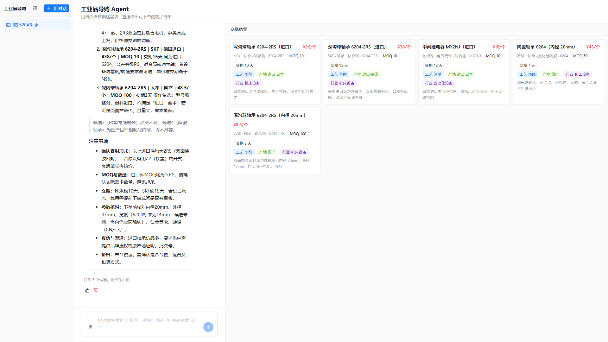

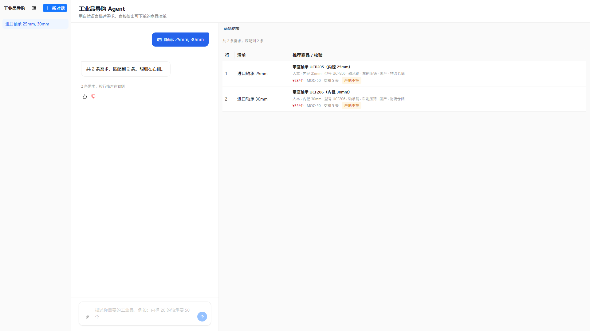

### 14. 结构化理解层：模型负责听懂，代码负责校验

规则能覆盖九成的说法，但接不住这几种：多个值（「25mm, 30mm」）、指代（「那个」「刚才说的」）、改口（「换成 M10」）、否定（「不要 304 的」）。每加一条都得再写一堆正则和词表，而且永远有下一个没覆盖到的说法。

所以加了一层：**一次模型调用**，把这句话连同前几轮理解成结构化结果。

```json
{
  "intent": "purchase",
  "rows": [
    { "name": "进口轴承", "spec": "内径 25mm", "quantity": null },
    { "name": "进口轴承", "spec": "内径 30mm", "quantity": null }
  ]
}
```

模型只负责「听懂」，**每个字段都要过一遍代码校验**：

1. `intent` 只能是 `purchase` / `chat` / `unknown`
2. `rows` 最多 5 行，每行 `name` 和 `spec` 至少有一个，`quantity` 必须是正整数
3. 校验不过的行直接丢掉；整段理解失败就返回 `None`，调用方**退回规则链路**——规则虽然笨，但不会把对话搞崩

这样分工的好处：

- **模型擅长的交给模型**：多值、指代、改口，这些规则写不完
- **代码擅长的交给代码**：精确的 M 号、数量、品类白名单，模型给什么都要过筛子
- **硬约束不被污染**：检索层拿到的永远是校验过的干净值，不会出现「M8 左右」这种没法过滤的东西

`?debug=1` 会把模型原始输出打出来，调提示词时直接看：

```powershell
Invoke-RestMethod 'http://127.0.0.1:8100/api/chat?q=德国轴承%206204&debug=true'
```

实测延迟：多轮里的补充句 1.2–2.4 秒，出清单的轮 6 秒左右（含推荐生成）。理解层用的是同一把 DeepSeek key，没有引入新依赖。

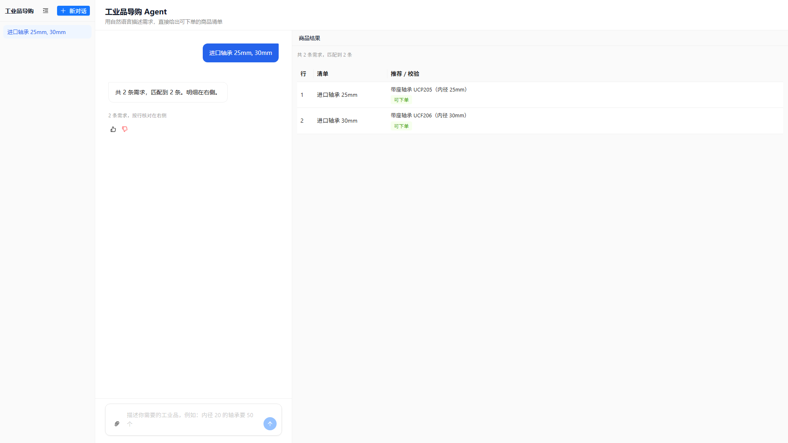

### 15. 流式回复：模型边说，前端边显示

推荐正文是模型现写的（300–500 字），一次性返回要等 6 秒左右，页面上什么都不动，很难判断是卡住了还是正在想。

所以加了 SSE：`POST /api/chat/stream` 返回 `text/event-stream`，按事件推进。

| 事件 | 时机 | 前端动作 |
| --- | --- | --- |
| `stage` | `understanding` → `retrieving` → `recommending` → `saving` | 显示当前在做什么 |
| `delta` | 推荐模型每吐一段文本 | 追加到当前气泡末尾 |
| `reset` | 模型中途失败，要换模板 | 清空已显示文本，避免前后矛盾 |
| `result` | 全部完成 | **整体替换**正文，并写入商品卡片、表格、选项、`message_id` |
| `error` | 无法形成结果 | 显示明确失败，不伪造成功 |

两个关键取舍：

1. **不伪造 token**。`delta` 只来自上游 `stream: true` 的真实增量，不是把完整回复按字数切开发。模型不支持流式或中途断了，就走 `reset` + 模板，不假装在流。
2. **最终以 `result` 为准**。替代品说明、城市提示都是推荐文本生成**之后**才拼上去的，流式过程中看不到；前端收到 `result` 时整体替换，保证显示文本、数据库正文、`message_id` 三者一致。

流式失败不落库：只有 `result` 形成后才各写一次用户消息和助手消息，半截文本永远不会进历史。切换会话或发起新请求时会 `AbortController.abort()`，旧流不会往新会话里写东西。

`/api/chat` 保持原样，非流式调用和测试脚本都不受影响。

### 16. 评估基线：规则指标先行，语义分只作参考

「效果不错」不算数。24 条人工标注用例覆盖五类场景，每次跑同一份数据，得到可对比的数字。

两层指标：

1. **确定性指标**（24 条全跑）——stage 准确率、Recall@3、MRR、行状态准确率、硬约束违反率、`match_kind` 准确率、严重可下单错误。指标算法不调模型，但只有用 `--replay` 从原始结果重算时才完全离线。
2. **RAGAS 语义指标**（只跑 `results` 分支，15 条适用）——`ContextPrecisionWithReference` / `ContextRecall` / `Faithfulness` / `AnswerRelevancy`（v0.4 collections 的实际类名），输入是真实检索上下文和真实回复，评估模型同样是 `deepseek-chat`，embedding 复用本地 bge-m3。

基线（2026-11-15，revision 2 口径）：

| 指标 | 值 | 覆盖 |
| --- | --- | --- |
| stage 准确率 | 0.9583 | 24 |
| match_kind 准确率 | 0.9375 | 16 |
| Recall@3 | 0.8958 | 16 |
| MRR | 0.8802 | 16 |
| 行状态准确率 | 0.9167 | 24 |
| 硬约束违反率 | 0.0 | 15 |
| 严重可下单错误 | 0 | 17 |
| ContextPrecisionWithReference | 0.7911 | 15 |
| ContextRecall | 0.7444 | 15 |
| Faithfulness | 0.3932 | 15 |
| AnswerRelevancy | 0.6924 | 15 |

**口径说明（v1 数值与 v2 不可直接比）：**

- Recall@3 与 MRR 用同一分母——有期望商品、有候选、且不是「缺参给参考」的用例；命中 0 分也计入。v1 的 MRR 0.95 只统计了命中行，v2 修正分母后是 0.8802，这是口径变化，不是检索变差。
- `match_kind` 只表示硬约束（规格/内径/长度）是否精确，软属性不符不改变它。v1 有两条标注把材质/产地偏好算成了 alternative，v2 已改 exact。
- 行状态来自 `evaluate_row()`，多需求逐行比对；严重错误的分母是「有候选的用例」，替代结果被判成可下单才计入。
- 多需求的候选来自各行 `items` 的并集；缺参行没有候选，不参与召回。

**三个读法，避免误判：**

- `Faithfulness` 在 0.36–0.50 之间波动，主要来自口径而不是编造。推荐正文里有大量「注意事项」（含税、账期、备损、安装建议），这些不在候选商品属性里，RAGAS 一律判成「不被上下文支持」。同一批用例四次重跑，这个指标从 0.36 到 0.50 都出现过，别拿单次结果下结论。
- `ContextRecall` 偏低有 reference 写法的因素。结构化短文本（分号拼接的属性行）会让 LLM 判定偏保守，看这条要看候选顺序，不是只看分数。
- **确定性指标优先**。stage、硬约束、`match_kind`、行状态不受评估模型影响，是回归时真正该盯的数；RAGAS 只建立分布，不设合格线。

跑法：

```powershell
cd backend
pip install -r requirements-eval.txt            # 评估依赖独立于生产
python -m eval.run_ragas --collect-only         # 只采集原始结果，写 docs/ragas-raw-*.json
python -m eval.run_ragas --replay docs/ragas-raw-2026-11-15.json   # 离线重算规则指标，零模型调用
python -m eval.run_ragas                        # 采集 + 规则 + RAGAS，约 6 分钟
```

`--rules-only` 仍然会调业务模型（理解/改写/推荐），它只是不跑 RAGAS，不是离线。真正离线的是 `--replay`。

结果写到 `docs/ragas-baseline-YYYY-MM-DD.json`（逐条原始数据）和同名 `.md`（汇总、薄弱案例、未覆盖范围）；`--replay` 输出带 `-replay` 后缀，不覆盖基线。

已知问题用例按原样保留，不为了让分数好看而删除——比如 `multi-rows-021`（「304 和 316 的 M8×30 螺丝」被拆成两行），它会一直暴露在基线里，修好了分数自然会变。

## 编排层：把分支搬成状态图

`_answer()` 原本是 157 行的线性实现，22 个分支藏在 if/else 里，`grep` 找不出谁调谁。迁移目标是把它变成显式的图和节点，**业务逻辑一行不改**——检索、精排、需求解析、推荐提示词全部原样复用，图只负责「什么时候调谁」。

```text
prepare ──► resolve_intent ──► expand_rows ──► parse ──► retrieve
   │              │                 │            │           │
   ├─ chat ───────┘                 ├─ multi     ├─ clarify   ├─ empty
   └─ debug                        └─ single    └─ 库外     └─ recommend
```

几个设计取舍：

- **State 每轮新建，不跨会话**。回调（stage/delta/reset）和取消闸门只活在单次请求里，不落库、不持久化，避免 A 用户的需求漏给 B。
- **不引入 checkpointer**。会话历史仍然只有 `sessions` / `messages` 一张表，图不存快照。
- **落库在图外**。`_chat()` 负责写消息，图节点不碰数据库——重复落库是这类迁移最常见的坑。
- **取消语义靠异常穿透**。`_StreamCancelled` 继承 `BaseException`，节点里抛出去能穿过 `graph.invoke`；这条在迁移前用 5 行实验验证过，不然「断开连接仍然落库」会退回去。
- **迁移完成后只留这一条路径**。迁移期用 `?engine=graph` 对照过 8 条输入，确认结构一致后删掉了旧线性实现和临时开关——同一份业务逻辑不维护两套，避免「改了 A 忘了 B」。

对照结果：8 条代表性输入（完整需求 / 缺参 / 库外 / 闲聊 / 多需求 / 替代 / 多轮）在 legacy 与 graph 下，stage、demand、items、rows、options 完全一致，只有 LLM 措辞长度不同。

切换之后，24 条规则评估跑下来只有一处差异：`multi-rows-021`（材质并列被拆成两行）的 MRR 从 0.5 变 1.0——因为那一轮的候选顺序变了，属于在线检索波动，不是结构回退。其余 stage、match_kind、R@3、行状态、硬约束、严重错误都与基线一致。

## 架构

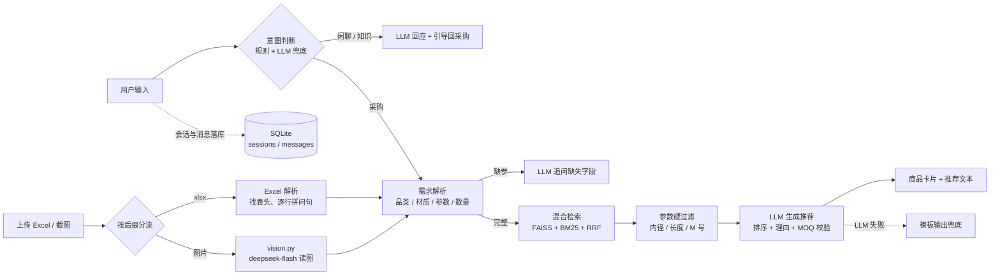

## 技术栈

| 层 | 选型 |
| --- | --- |
| 后端 | FastAPI + Uvicorn |
| 存储 | SQLite（45 条种子商品 + 会话记录，`data/products.db`） |
| 向量 | sentence-transformers + bge-m3（1024 维）+ FAISS |
| 关键词 | jieba + rank_bm25 |
| LLM | DeepSeek `deepseek-chat`（OpenAI 兼容接口） |
| 前端 | Vite + React + TypeScript + antd 6 + Ant Design X（Bubble / Welcome / Prompts / Sender）+ XMarkdown |

## 快速开始

**1. 准备环境**

需要 Python 3.10+，依赖见 `backend/requirements.txt`（fastapi / uvicorn / faiss-cpu / jieba / rank-bm25 / numpy / sentence-transformers），另外 LLM 调用用到 `requests`。bge-m3 模型需要提前下载到本地，路径在 `backend/app/rag/embedder.py` 的 `MODEL_DIR` 里配置（默认 `D:\AI\models\bge-m3`）。

**2. 配置 API Key（两种方式，选一个）**

代码读的是 `os.getenv("DEEPSEEK_API_KEY")`，`.env` 只是本地开发的兜底——**没有这个文件也能跑**，只要环境变量在。

**方式一：项目根建 `.env`（本地开发推荐）**

```powershell
Copy-Item .env.example .env      # bash/zsh 用 cp .env.example .env
```

然后填 key：

```ini
DEEPSEEK_API_KEY=sk-xxxxxxxx
DEEPSEEK_BASE_URL=https://api.deepseek.com/v1
DEEPSEEK_MODEL=deepseek-chat
```

**方式二：直接给进程环境变量（部署 / CI 推荐，不用建文件）**

```powershell
$env:DEEPSEEK_API_KEY = "sk-xxxxxxxx"        # 只在当前终端有效
# 需要长期有效就写进用户环境变量，设完要重开终端
[Environment]::SetEnvironmentVariable("DEEPSEEK_API_KEY", "sk-xxxxxxxx", "User")
```

```bash
export DEEPSEEK_API_KEY=sk-xxxxxxxx          # Linux / macOS
```

> `.env` 已在 `.gitignore` 里，从来没进过 git 对象库；仓库里只有 `.env.example`（占位符，没有真实 key）。加载逻辑用 `os.environ.setdefault`，所以**环境变量优先，`.env` 只补缺的值**，两者不会打架。

**3. 起后端**

```powershell
cd backend
python -m app.seed          # 首次：写入 48 条种子商品
python -m uvicorn app.main:app --port 8100
```

启动时会加载 bge-m3 并为商品建 FAISS + BM25 索引（首次启动包含模型加载，视机器而定）。`embedder.py` 里默认用 `device="cuda"`，没有 GPU 的机器改成 `"cpu"`。

**索引是增量持久化的**：向量和内容哈希存在 `data/index/` 下（`vectors.npy` / `ids.json` / `hashes.json` / `meta.json`），商品文本没变就复用旧向量，只有新增或改过文本的商品才重新编码。冷启动时直接读盘，不再全量重算；模型标识或格式版本对不上会明确走全量重建，文件损坏也一样，不会拿错配的向量冒充。FAISS 和 BM25 每次同步全量重建——几十条数据重建成本极低，换来的是 `rows / ids / texts / vectors` 的位置映射与检索端完全一致。

改完商品数据后可以手动同步：

```powershell
Invoke-RestMethod -Method Post http://127.0.0.1:8100/api/index/sync
# {"products":48,"encoded":0,"reused":48,"synced_at":"..."}
```

**4. 起前端**

```powershell
cd frontend
npm install
npm run dev                 # http://localhost:5200
```

> 前端依赖 antd 6 / @ant-design/x / @ant-design/x-markdown，版本见 `frontend/package.json`；首次 `npm install` 约 4 分钟。
>
> Windows + PowerShell 下如果 `npm` 报「无法加载文件 npm.ps1」，改用 `npm.cmd run dev`。

**5. 直接调接口**

```powershell
$q = [uri]::EscapeDataString("内径 20 的轴承要 50 个")
Invoke-RestMethod "http://127.0.0.1:8100/api/chat?q=$q"
```

## 目录结构

```
industrial-shopping-agent/
├─ backend/
│  ├─ app/
│  │  ├─ main.py          # 路由：/api/chat（GET/POST）、/api/chat/upload、/api/sessions、/api/feedback、/api/search、/api/index/*、/api/health
│  │  ├─ demand.py        # 意图判断 + 需求解析 + 缺参判断 + 多轮合并 + 追问选项
│  │  ├─ prompts.py       # 六组提示词：意图 / 追问 / 闲聊 / 库外 / 推荐 / 改写
│  │  ├─ sessions.py      # 会话与消息持久化 + 评价（feedback 表）
│  │  ├─ excel.py         # Excel 清单解析：找表头、逐行拼检索问句
│  │  ├─ vision.py        # 图片识别：调 deepseek-flash 出结构化商品行
│  │  ├─ llm.py           # DeepSeek 调用
│  │  ├─ db.py models.py seed.py
│  │  └─ rag/
│  │     ├─ embedder.py   # bge-m3 编码
│  │     ├─ index.py      # 商品编码文本 + build_index 兼容入口
│  │     ├─ index_manager.py  # 向量持久化与按内容增量编码
│  │     └─ retriever.py  # 混合检索 + RRF + 硬过滤
│  └─ requirements.txt
├─ frontend/
│  └─ src/
│     ├─ App.tsx          # 会话侧栏 + 对话列 + 结果区 + 多选选项 + 上传
│     └─ App.css          # 三栏布局 + 会话列表 + Markdown 排版
├─ data/products.db
└─ docs/
   ├─ ui-home-antd.png    # 首页空态
   ├─ ui-chat-antd.png    # 对话与商品卡片
   ├─ ui-excel.png        # Excel 上传结果
   ├─ ui-vision.png       # 商品截图识别结果
   ├─ ui-session.png      # 会话侧栏与历史恢复
   ├─ ui-options.png      # 追问选项按钮（可多选）
   ├─ ui-multi.png        # 多需求表格
   ├─ ui-feedback.png     # 回答评价按钮
   ├─ test-checklist.md   # 自测清单
   └─ demo-video-script.md
```

## 设计说明

- **为什么规则优先判意图**：采购问句有强特征（品类词 + 参数/数量），规则能覆盖绝大多数，比每句都过 LLM 更快更省；规则判不出时 LLM 兜底，两边都不丢。
- **为什么用 RRF 而不是加权分数**：向量相似度和 BM25 分数量纲不同，RRF 只看排名，免调权重，小数据集上更稳。
- **为什么要硬过滤**：向量检索对「M8」这种短参数不敏感，容易把 M10 排前面；参数命中时直接过滤，精确性优先。
- **为什么保留模板兜底**：演示场景下 LLM 可能超时/限流，模板能保证一定能出清单，不会白屏。
- **为什么用 SQLite + 增量索引**：几十条数据规模小，免去向量库运维；索引按内容哈希增量编码并持久化到 `data/index/`，冷启动不用重算，商品文本变了才重新编码。

## 已知限制

- 种子数据只有 3 个品类 45 条，未接真实电商目录，价格/库存非实时
- 参数抽取是正则规则，只覆盖内径/长度/M 号/电压电流，不含公差、强度等级、防护等级等
- 多轮上下文只回放最近 8 条消息，更早的轮次不参与；会话已落库（`sessions` / `messages`），刷新和换标签页都能恢复，但没有账号体系，所有人共用一个库
- 检索排序偏弱：单轮只给「M8」不给长度时会追问长度，但 Excel 行里写成「M8 螺丝 1000 个」这种缺长度的，首位仍可能是 M8×5；写上 M8×30 会走长度硬过滤，能排对
- 追问选项给的是行业标准规格，不是库存清单，点了之后库里可能没有对应 SKU，会落到「没有匹配的商品」——有意为之，标准规格该有，现货另说
- Excel 只读第一个 sheet，不处理多表头、合并单元格、多 sheet 的复杂格式；列名靠关键词猜，认不出时按「第一列品名、第二列规格」兜底
- 图片识别只保证清单类截图（表格、订单、标签），实物照片只能判出品类，判不出 M8×30 这种尺寸；手写体、倾斜、模糊的图会漏行
- 推荐文本由 LLM 生成，偶有候选编号与列表顺序不完全对应，前端以卡片列表为准
- 评价没有账号体系，同一台机器上谁都能点，只看总量趋势；差评里没有强制填原因，定位具体问题要人工回看对话
- 多需求表格每行只显示首推商品，完整候选要单需求时才展开；多行里缺参数的行不给追问，只给参考候选并标「缺参数」
- 结果区不能折叠，窗口窄于 1200px 时对话区自动收到 400px，再窄就没做响应式适配了
- 索引是进程内同步的：同步期间会占用一次编码，商品量大时该阻塞会变长，届时需要改成后台任务加进度查询

## 后续计划

- 扩展品类与真实商品源（爬虫/开放目录），验证万级 SKU 下的检索质量
- 商品详情页与询价单导出（当前只到「推荐 + 校验」）
- 补充接口测试与检索相关性评估集

## 接口一览

| 接口 | 说明 |
| --- | --- |
| `POST /api/chat` | 主入口（多轮）：body `{"q": "...", "session_id": "...", "history": [...]}`，带 `session_id` 时历史从库里取并自动落库；命中多需求时返回 `rows` + `summary`（`stage: "multi"`） |
| `POST /api/chat/stream` | SSE 流式入口：body 同上，返回 `text/event-stream`。事件 `stage`（`understanding` / `retrieving` / `recommending` / `saving`）、`delta`（推荐模型真实 token 增量）、`reset`（中途失败，前端清空已显示文本）、`result`（与 `/api/chat` 一致的完整结果，含 `message_id`）、`error`。正文以 `result.reply` 为准，前端收到后整体替换 |
| `GET /api/chat?q=` | 单轮入口：不带历史的简化版，行为与上面一致（无上下文合并） |
| `POST /api/chat/upload` | 上传采购清单或商品截图：multipart 字段 `file` + 可选 `session_id`，收 `.xlsx` / `.xlsm` / `.png` / `.jpg` / `.jpeg` / `.webp`，返回逐行匹配结果 |
| `POST /api/sessions` | 新建会话，返回 `{id, title, created_at, updated_at}` |
| `GET /api/sessions` | 会话列表，按更新时间倒序，带消息条数 `count` |
| `GET /api/sessions/{id}` | 会话详情 + 全部消息（含 payload：商品卡片、表格、追问选项） |
| `DELETE /api/sessions/{id}` | 删除会话及其消息 |
| `POST /api/feedback` | 给一条助手回复点赞/点踩：body `{"message_id": 3, "rating": "up"\|"down"}`，重复提交以最后一次为准 |
| `GET /api/feedback/stats` | 好评数、差评数、评价率（`up` / `down` / `rated` / `rate`） |
| `GET /api/search?q=&top_k=` | 只做解析与检索，不调 LLM（调试用） |
| `POST /api/index/sync` | 按内容哈希增量同步索引，返回 `products` / `encoded` / `reused` / `synced_at` |
| `GET /api/index/status` | 索引状态：商品数、最后同步时间、模型标识、向量维度、持久化是否可用 |
| `GET /api/categories` | 品类及商品数 |
| `GET /api/products/{id}` | 商品详情 |
| `GET /api/health` | 健康检查：商品数、LLM 是否已配置 |
